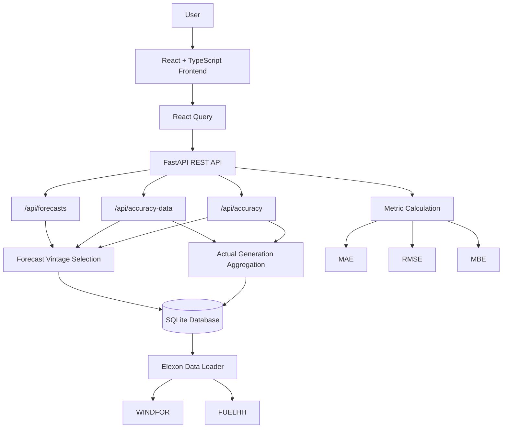

# Yuragi

> **Wind generation forecast decision-support dashboard for UK day-ahead electricity purchasing**

Yuragi is a full-stack decision-support application for exploring UK wind-generation forecasts and evaluating how accurately those forecasts matched actual generation.

The application focuses on a practical purchasing question:

**Given the forecast that was available when a buyer made the day-ahead decision, what was the forecast for tomorrow's wind generation, and how accurate was it?**

Yuragi uses national-level UK wind data from **Elexon** for January 2026 and applies forecast-vintage selection based on the buyer's decision time.

---

## Features

### Forecast Explorer

Explore the wind-generation forecast available for a selected delivery day and decision time.

- Select a delivery date
- Select the decision time in UTC
- View forecast wind generation across the delivery day
- Inspect individual forecast points through chart tooltips
- See when the selected forecast was published
- Handle unavailable and partially available forecast intervals

### Forecast Accuracy Analysis

Compare day-ahead wind forecasts against actual generation over a selected date range.

- Select a start date and end date
- Select the decision time in UTC
- Compare forecast vs actual generation
- Drill into individual delivery days
- Inspect absolute error for individual intervals
- View:
  - **MAE**: Mean Absolute Error
  - **RMSE**: Root Mean Square Error
  - **MBE**: Mean Bias Error
- View the number of valid matched intervals

---

## Forecast Vintage Selection

The key business logic in Yuragi is selecting the forecast that was actually available when the purchasing decision was made.

For a delivery date `D`, the buyer makes the decision on `D - 1`.

For each delivery interval:

1. Find forecasts for that delivery interval.
2. Keep forecasts published on the decision date.
3. Keep only forecasts published at or before the selected decision time.
4. Select the latest eligible publication.

In other words:

```text
delivery_date = decision_date + 1 day

eligible forecasts:
    publish_date == decision_date
    AND publish_time <= decision_time

selected forecast:
    MAX(publish_time)
```

This prevents the analysis from accidentally using a forecast that had not yet been published when the purchasing decision was made.

---

## Data Sources

Yuragi uses the **Elexon BMRS API**.

### WINDFOR

Used for wind-generation forecasts.

Relevant fields:

- `startTime`: delivery interval being forecast
- `publishTime`: forecast publication timestamp
- `generation`: forecasted wind generation

### FUELHH

Used for actual wind generation.

Relevant fields:

- `startTime`: delivery interval
- `generation`: actual generation
- `fuelType`: filtered to `WIND`

FUELHH actual generation is provided at 30-minute resolution. Yuragi aggregates the two half-hour values within each hour using their **average** for forecast-vs-actual comparison.

---

## Architecture



---

## Frontend Architecture

```text
frontend/
├── components/       # Reusable UI and chart components
├── layouts/          # Shared page layout and controls
├── pages/            # Forecast and accuracy pages
├── queries/          # React Query hooks
├── services/         # API/HTTP functions
├── types.ts          # Shared TypeScript types
└── App.tsx           # Application routing
```

## Backend Architecture

```text
backend/
├── routes/           # FastAPI route handlers
├── services/         # External Elexon API integration
├── utils/            # Forecast selection, aggregation and metrics
├── tests/            # Backend tests
├── data/             # Local SQLite database
├── database.py       # Database setup and data loading
└── main.py           # FastAPI application entry point
```

---

## Tech Stack

### Frontend

- React
- TypeScript
- Vite
- React Router
- TanStack React Query
- Axios
- Recharts
- Framer Motion
- Phosphor Icons
- Tailwind CSS

### Backend

- Python
- FastAPI
- Uvicorn
- SQLite
- NumPy
- Requests
- Pydantic

### Deployment

- Vercel
- Vercel Python Runtime
- Elexon BMRS API

---

## API

### `POST /api/forecasts`

Returns the latest forecast available at the selected decision time for the requested delivery date.

Request:

```json
{
  "deliveryDate": "2026-01-04",
  "decisionTime": "03:00"
}
```

---

### `POST /api/accuracy-data`

Returns matched forecast and actual generation values for a selected date range.

Request:

```json
{
  "startDate": "2026-01-04",
  "endDate": "2026-01-10",
  "decisionTime": "03:00"
}
```

---

### `POST /api/accuracy`

Returns aggregate forecast accuracy metrics for a selected date range.

Request:

```json
{
  "startDate": "2026-01-04",
  "endDate": "2026-01-10",
  "decisionTime": "03:00"
}
```

---

## Running Locally

### Backend

```bash
cd backend

python -m venv .venv
```

Activate the environment.

**Windows PowerShell:**

```powershell
.\.venv\Scripts\Activate.ps1
```

**macOS / Linux:**

```bash
source .venv/bin/activate
```

Install dependencies:

```bash
pip install -r requirements.txt
```

Start the API:

```bash
uvicorn main:app --reload
```

The backend will be available at:

```text
http://localhost:8000
```

FastAPI documentation:

```text
http://localhost:8000/docs
```

On startup, the backend initializes the SQLite database and loads the required Elexon data if the local database is empty.

### Frontend

Open another terminal:

```bash
cd frontend
npm install
npm run dev
```

The frontend will normally be available at:

```text
http://localhost:5173
```

The API base URL is configured in:

```text
frontend/src/services/api.ts
```

---

## Docker

### Backend

`backend/Dockerfile`:

```dockerfile
FROM python:3.12-slim

WORKDIR /app

COPY requirements.txt .

RUN pip install --no-cache-dir -r requirements.txt

COPY . .

EXPOSE 8000

CMD ["uvicorn", "main:app", "--host", "0.0.0.0", "--port", "8000"]
```

Build and run:

```bash
cd backend

docker build -t yuragi-backend .

docker run -p 8000:8000 yuragi-backend
```

---

### Frontend

`frontend/Dockerfile`:

```dockerfile
FROM node:22-alpine AS build

WORKDIR /app

COPY package*.json ./

RUN npm ci

COPY . .

RUN npm run build


FROM nginx:alpine

COPY --from=build /app/dist /usr/share/nginx/html

COPY nginx.conf /etc/nginx/conf.d/default.conf

EXPOSE 80

CMD ["nginx", "-g", "daemon off;"]
```

The frontend uses Nginx to serve the Vite production build.

Build and run:

```bash
cd frontend

docker build -t yuragi-frontend .

docker run -p 5173:80 yuragi-frontend
```

---

### Nginx SPA Configuration

Because Yuragi uses client-side routing, direct navigation or refreshing routes such as `/accuracy` must fall back to `index.html`.

`frontend/nginx.conf`:

```nginx
server {
    listen 80;
    server_name _;

    root /usr/share/nginx/html;
    index index.html;

    location / {
        try_files $uri $uri/ /index.html;
    }
}
```

---

## Accuracy Metrics

Forecast error is calculated as:

```text
error = forecast - actual
```

### MAE

Mean Absolute Error measures the average magnitude of forecast error.

```text
MAE = (1/n) Σ |Forecast - Actual|
```

### RMSE

Root Mean Square Error penalises larger errors more heavily.

```text
RMSE = √[(1/n) Σ (Forecast - Actual)²]
```

### MBE

Mean Bias Error measures the average direction of forecast error.

```text
MBE = (1/n) Σ (Forecast - Actual)
```

Interpretation:

- Positive MBE → forecasts tend to over-predict
- Negative MBE → forecasts tend to under-predict
- MBE near zero → little systematic directional bias

---

## Actual Generation Aggregation

The raw FUELHH actual-generation data is stored at its original 30-minute resolution.

For forecast-vs-actual comparison, Yuragi groups the two half-hour records belonging to the same hour and calculates their average:

```text
Hourly actual generation
=
(30-minute value 1 + 30-minute value 2) / 2
```

The values are **not summed**, since the records represent MW generation measurements rather than energy quantities.

---

## Project Structure

```text
oiiiiaiiiooo/
│
├── backend/
│   ├── data/
│   │   └── yuragi.db
│   ├── routes/
│   │   ├── accuracy.py
│   │   ├── accuracy_data.py
│   │   └── forecasts.py
│   ├── services/
│   │   └── elexon.py
│   ├── tests/
│   ├── utils/
│   │   ├── calculate_metrics.py
│   │   ├── fetch_actual.py
│   │   └── fetch_forecast.py
│   ├── database.py
│   ├── Dockerfile
│   ├── main.py
│   └── requirements.txt
│
├── frontend/
│   ├── public/
│   ├── src/
│   │   ├── components/
│   │   ├── layouts/
│   │   ├── pages/
│   │   ├── queries/
│   │   ├── services/
│   │   ├── App.tsx
│   │   └── types.ts
│   ├── Dockerfile
│   ├── nginx.conf
│   ├── vercel.json
│   ├── package.json
│   └── vite.config.ts
│
└── README.md
```

---

## Deployment

### Frontend

The frontend can be deployed to Vercel as a Vite application.

The project includes a Vercel SPA rewrite so refreshing routes such as `/accuracy` does not result in a 404:

```json
{
  "rewrites": [
    {
      "source": "/(.*)",
      "destination": "/index.html"
    }
  ]
}
```

The frontend API configuration should point to the deployed backend rather than `localhost`.

### Backend

The FastAPI application can be deployed using Vercel's Python runtime.

The application entry point is:

```python
app = FastAPI(title="Yuragi Backend")
```

---

## SQLite Deployment Note

The current implementation uses a local SQLite database and loads Elexon data when the database is empty.

This is suitable for the assignment/demo setup, but serverless environments do not provide durable local database storage across function instances.

For a production system, the database should be moved to persistent external storage such as a managed PostgreSQL or other serverless-compatible database.

---

## Development Checks

Frontend build:

```bash
cd frontend
npm run build
```

Frontend lint:

```bash
cd frontend
npm run lint
```

Backend:

```bash
cd backend
uvicorn main:app --reload
```

---

## Design Principle

Yuragi is built around one core decision-support principle:

> **Show the buyer the forecast they could actually have seen, not a forecast published later with the benefit of hindsight.**

By combining forecast-vintage selection, actual-vs-forecast comparison, and interpretable error metrics, Yuragi provides a compact view of how useful the wind forecast was at the point of purchase.

## AI Assistance

AI tools were used during the development of Yuragi as a development aid. This included assistance with debugging, implementation suggestions, code review, documentation, and explaining technical concepts.

The core application design, business logic, data interpretation, forecast-vintage selection logic, API structure, UI decisions, and final implementation choices were reviewed and adapted as part of the development process.

AI assistance was used to accelerate development and problem-solving, rather than as a replacement for understanding or validating the implementation.
